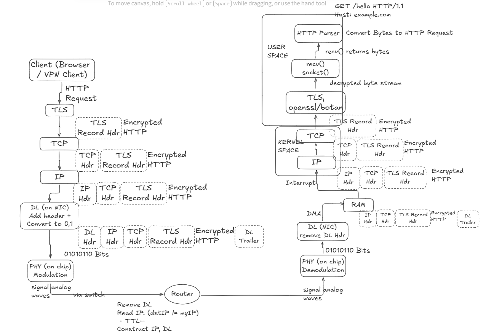

:toc:
:toclevels: 5

== HTTP Request Parser
- recv() System call on Linux gets raw bytes from kernel. HTTP Request Parser will convert these bytes/chunks to HTTP.

== Requirements
=== Functional
- Support incremental parsing: TCP data can arrive in chunks
- Handle HTTP/1.1 request lines, headers, and bodies, including Content-Length and chunked transfer encoding.
- Handling longlived & multiple requests on the same socket.

=== Non-Functional
- Reliabile: 
** Reject ambiguous or malformed framing, invalid header, oversized requests/headers, and incomplete requests after timeout.
** Never reinterpret bytes.
- Throughput: req/sec
- Latency: Max Parsing latency
- Max concurrent connections
- Memory limit per connection
- DDOS prevention: Methods to prevent denial-of-service attacks.

== Flow
- HTTP Packet 
