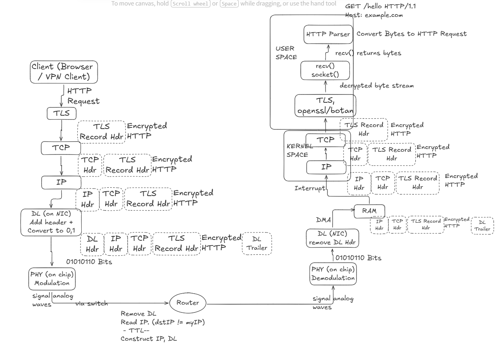
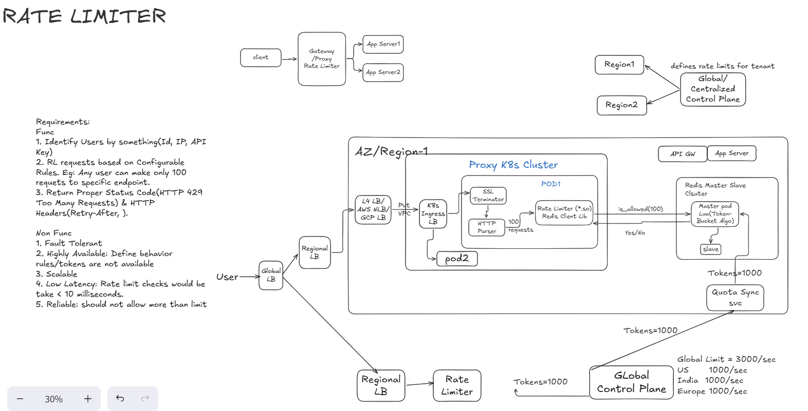
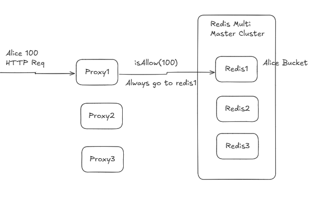

:toc:
:toclevels: 5

= Rate Limiter 

== What is Rate Limiter
- Consider Users are using Social media Apps(Facebook, Instagram, Twitter) or browsing on google etc
- RL will limit requests made by 1 USER in specific time frame. For example 100 requests/min/user
- **Why RL?** Protect backend services from abuse(Spamming with 1000's of requests to hog CPU and making system unusable for other users)

== Questions to Interviewer
- What we are Rate limiting?
** User facing application (eg: Facebook)?
** RL between intra micro services?

== Requirements
=== Functional (Features of system)
1. Identify Users by something(Id, IP, API Key)
2. Limit requests based on Configurable Rules. Eg: Any user can make only 100 requets to specific endpoint.
** Alice can make 100 req/sec
** API X can make 500 req/sec
3. Return HTTP Status Code(429 Too Many Requests) & link:https://code-with-amitk.github.io/Networking/OSI-Layers/Layer-7/HTTP/HTTP%20Headers.html#X-RateLimit[HTTP Headers(X-RateLimit-Limit, X-RateLimit-Remaining, X-RateLimit-Reset)]. Headers will tell after how much time user can retry.

=== Non Func
From link:/System-Design/Concepts/Terms/README.adoc#cap-theorem-consistency-availability-partition-tolerance[CAP Theorem], this should be **AP(Highly Available, Parition Tolerant)**, eventual consistent system

- link:/System-Design/Concepts/Terms/README.adoc#cap-theorem-consistency-availability-partition-tolerance[Fault Tolerance / Partition Tolerance]: Every distributed System should always be partition tolerant, ie if link between datacenter in US and datacenter in India is broken. Service should still function, it should not globally shut down.
- Highly Available: Define behavior rules/tokens are not avialable. Should RL go offline until all rules are propagated? We choose highly available.
- Scalable: Ask Interviewer(What is Scale?).
```
Consider, 100M DAU. 1 user send 1000 requests/day. 
Total Request/day 100Mx1000 = 100000 M
Requests/sec = 100000 M / 86400 = 1 Million req/sec
```
- Low Latency: Rate limit checks would be take < 10 milliseconds.
- Reliable: should not allow more than limit



== Core Entities
- HTTP Request
- Client(who is making the request) identified using IP, userId, API Key etc
- Rules. Eg: 100 requets/user/sec

== API / System Interface
- Function to ask whether clientId is allowed or not?
```
bool isRequestAllowed(clientId, ruleId)
```

== HLD
=== AWS NLB (Layer 4 Forwarding. TCP)
- NLB operates purely at the transport layer (TCP). It does not decrypt the traffic, hence cannot read headers. It forwards TCP to 1 of healthy Kubernetes cluster nodes using a standard 5-tuple hash routing algorithm.
- Forwarding done on 5-tuple hash routing algorithm.

=== Proxy / Gateway (SSL Term + Rate Limiting(*.so)) (Layer 7)
- Proxy will run following:
```
┌──────  Single Proxy Container ─────────────────────────┐
│  1. SSL Termination (Decrypts HTTPS to HTTP)           │
│  2. HTTP Parser                                        │
│  3. Rate limiter *.so (having redis client library)    │
│  4. Route to Microservice Backend                      │
└────────────────────────────────────────────────────────┘
```



==== 1. SSL Termination
- Proxy uses its installed link:/Networking/OSI-Layers/Layer-7/Protocols/Encryption_Authentication/Certificates.adoc[SSL/TLS certificates] to decrypt the incoming HTTPS traffic to HTTP
- From decrypted HTTP proxy parses `Path: /v1/checkout`, `Tenant ID: X-Tenant-ID: tenant_test`, JWT claims etc
- Proxy need to decrypt HTTP Packet to see the following and apply
** Request URI(`GET /users HTTP/1.1`) to apply `Endpoint(/users)` based rate limiting
** User is present in HTTP header. Per user Rate limiting
- Also Proxy need to send HTTPS Reponse(429) hence it must establish the link:/Networking/OSI-Layers/Layer-7/Protocols/Encryption_Authentication[TLS handshake], setup TLS to encrypt HTTP 429 response.

==== 2. HTTP Parser
- Bytes from `recv()` system call are fed HTTP Parser, which extracts the link:https://code-with-amitk.github.io/Networking/OSI-Layers/Layer-7/HTTP/HTTP%20Headers.html[HTTP headers] and request path (e.g., POST /v1/charges). It determines if this specific route or user has a rate limit policy applied to it.

==== 3. *.so (Rate limiter) + redis client library
- This process have link:https://code-with-amitk.github.io/System_Design/Scalable/Distributed_Cache/#redis-client[redis client library], which calls redis `bool isAllowed(userId, int num_of_requests)` function. Redis will return response yes or no
```c
rateLimiter.isAllowed(userId, n Http requests)         // In Go or C++
```

=== Redis Cluster
==== All Allowed or All Dropped
- Proxy recieves 100 HTTP requests and asks `isAllowed(userId=123, 100)` from redis master pod.
** If the bucket has >= 100 tokens: It subtracts exactly 100 tokens, and returns 1 (Allowed).
** If the bucket has < = 100 tokens: It leaves the token balance untouched and returns 0 (Blocked).
- Redis pod executes the link:/DS_Questions/Algorithms/Token_Bucket[Token Bucket Algorithm] inside Lua script to check Do I have 100 tokens, if has returns Binary 1(Yes), if has 90 tokens returns 0(No). No token counts are sent back to proxy. Other Algorithms & comparison:
** link:/DS_Questions/Algorithms/Token_Bucket[Fixed Window Counter, Sliding Window Log, Sliding Window Counter]
- Instead of sending multiple network packets by Application(ie Rate limiter pods) to Redis (GET/SET), the entire token-checking and decrementing logic is pushed to Redis as a single script execution (EVAL or EVALSHA).
- EVAL=Read-Modify-Write. Application will Read in 1 HTTP Packet, then Modify in other HTTP Packet. Both are done in EVAL at once

==== Configuration-1 (Master Slave)
- All proxy pods connect to same Redis Master Pod. Replica Pod sits right next to it, asynchronously replicating Master Pod's memory state.
- **Failover** If Master Pod goes offline, the cluster automatically promotes Replica Pod to be the new Master.


==== Configuration-2 (Master Master)



- t=0, Proxy/Gateway gets Alice HTTP request and calls `isAllowed(alice,1)` function on Redis pod-1.
- t=1, 100 requests comes from Alice, proxy call `isAllowed(alice,100)` and should go to same redis pod-1, because alice token count cannot be replicated to all redis pods This will create lot of data for 1M users.

===== Sharding Redis
- Meaning how proxy/gateway reache particular redis pod?
- Every redis pod would be sharded using Shard key = userIds or IP Address or API Key.
- keys on redis pods can be distributes using 
** link:/System-Design/Concepts/Hashing/README.md[Consistent Hashing]
** link:https://code-with-amitk.github.io/System_Design/Scalable/Distributed_Cache/#rediscluster[Hash calculation on Redis] 

Multi-Master Redis pods reads token count from link:https://code-with-amitk.github.io/System_Design/Concepts/Kubernets/Terms.html#pvc[PVC], return True/False and decrement token count on PVC.
```
Rate Limiter pod-a                 Redis Pod                   Rate Limiter pod-b
    t=0(isAllowed())                                        t=0(isAllowed())
            |------- call API ---> Read/Write PVC <-------------------|
                            THIS IS Critical Section and Lua script
                             executes
```

=== Quota Service
- The Global Control Plane calculates global allocations (e.g., Tenant X has 1000 tokens/sec total, split across 3 regions).
- The Regional Quota Service periodically polls or receives push notifications from the Control Plane, updating the regional Redis cluster or local memory pools with the newly authorized regional quotas.

== Non Functional Requirements
=== High Availablilty/fault Tolerance
- if Redis-pod-1 fails, and Alice bucket was on that Redis pod. We have 2 options:
** Fail Open: Rate limiter is down, every single request gets through. All backend services are bombarded and may die 1 by 1.
** Fail Close(Choose this): Rate limiter is down, no request should get through. Service is down and users maybe upset for some time.
- REPLICAS. Redis pod has 1 or 2 replicas. When one goes down, other will become master and all reads comes to replicate

=== Low Latency
1. Redis Client library(on proxy) does not create new connection to redis every time, rather it reuses the connection using connection pooling. It automatically does it. This reduces TCP Handshake time for every request(some milliseconds)
2. Proxy and redis should be in same data center

== 1 Packet Flow
```mermaid
sequenceDiagram
    autonumber
    actor Client as Mobile
    participant DNS as DNS
    participant NLB as AWS NLB<br>Layer 4
    box PROXY CLUSTER MULTIPOD
        participant Gateway@{ "type" : "collections" } as K8s Ingress LB
        participant TLS as TLS Terminator
        participant RL as Rate Limiter<br>(.so Middleware)
        participant Cache@{ "type" : "database" } as Token Bucket in RAM
    end
    participant Redis as Regional<br>Redis Cluster
    participant C as Checkout Svc
    participant F as Forwarder

    Client->>DNS: api.tenant.com
    DNS-->>Client: NLB IP address

    Client->>NLB: HTTPS/1.1 443
    Note over NLB: Layer 4 forwarding<br>using TCP 5-tuple hash

    NLB->>Gateway: Healthy Kubernetes node / gateway
    

    Gateway->>TLS: HTTPS
    TLS->>TLS: Decrypt HTTPS
    TLS->>TLS: Parse HTTP request and extract metadata
    Note over TLS: Path: /v1/checkout
    Note over TLS: X-Tenant-ID: tenant_acme_corp_88
    Note over TLS: Extract API key / JWT claims

    TLS->>RL: Invoke in-process<br>rate limiter
    RL->>Cache: Check tenant token bucket

    alt Local tokens available
        Cache->>Cache: Atomically decrement<br>token count
        Cache-->>RL: Token available
    else Local token chunk depleted
        Cache-->>RL: Cache miss / insufficient tokens
        RL->>Redis: EVALSHA Lua script<br>(atomic token lease)
        Redis->>Redis: Validate quota <br> allocate token lease
        Redis-->>RL: Return tokens
        RL->>Cache: Refill local token bucket
        RL->>Cache: Consume token
    end

    Note over C: Get Tokens from Global<br>Control Plane
    C->>Redis: Tokens filled
    opt Periodic synchronization
        RL->>Redis: EVALSHA Lua script<br>(sync counts / replenish lease)
        Redis-->>RL: Updated quota / token lease
    end

    alt Rate limit exceeded
        RL-->>Gateway: OVER_LIMIT
        Gateway->>Gateway: Short-circuit request
        Gateway-->>NLB: HTTP 429 Too Many Requests
        NLB-->>Client: Forward HTTP 429 response
    else Within quota
        RL-->>Gateway: OK
        Gateway->>F: Forward HTTP request<br>via ClusterIP
        Gateway-->>NLB: Forward HTTP 200 response
        NLB-->>Client: Return HTTP 200 OK
    end
```
