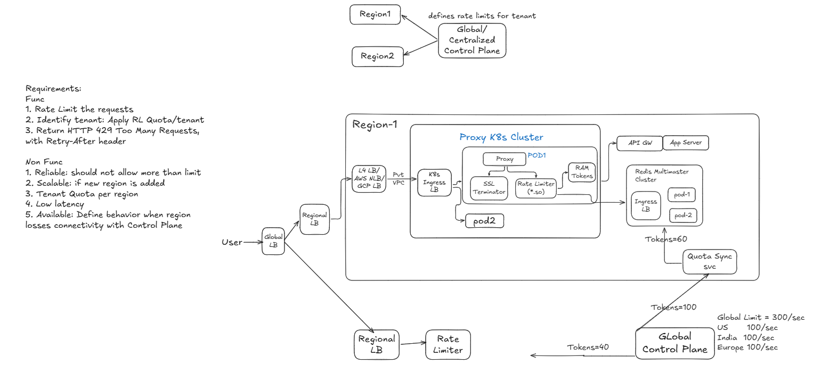

:toc:
:toclevels: 5

= Rate Limiter 

== Requirements
=== Func
1. Rate Limit the requests
2. Identify tenant: Apply RL Quota/tenant
3. Return HTTP 429 Too Many Requests, with Retry-After header

=== Non Func
1. Reliable: should not allow more than limit
2. Scalable: if new region is added
3. Tenant Quota per region
4. Low latency
5. Available: Define behavior when region losses connectivity with Control Plane

== HLD
=== AWS NLB (Layer 4 Forwarding. TCP)
- NLB operates purely at the transport layer (TCP). It does not decrypt the traffic, hence cannot read headers. It forwards TCP to 1 of healthy Kubernetes cluster nodes using a standard 5-tuple hash routing algorithm.
- Forwarding done on 5-tuple hash routing algorithm.

=== Proxy / Gateway (SSL Term + Rate Limiting(*.so)) (Layer 7)
- Proxy node will run 1 binary which will do SSL Termination + rate limiting
- Steps 1, 2, 3, and 4 happen inside the same process memory space, there are no network hops between the SSL terminator, the gateway, and the rate limiter.
```
┌──────  Single API Gateway Pod / Container ─────────────┐
│  1. SSL Termination (Decrypts HTTPS to HTTP)           │
│  2. Authentication & Header Extraction (Gets Tenant ID)│
│  3. RATE LIMITER MIDDLEWARE (In-process code/library)  │
│      ├── Checks Local RAM Cache (< 0.1ms)              │
│      └── Updates Local/Redis Counters                  │
│  4. Route to Microservice Backend                      │
└────────────────────────────────────────────────────────┘
```



==== 1. SSL Termination
Every line in link:https://code-with-amitk.github.io/Networking/OSI-Layers/Layer-7/HTTP/AdvDis_Features_Methods.html[HTTP Request] is terminated by \r\n
```
GET /v1/orders/12345 HTTP/1.1\r\n            <<<<< Format (Method Request-URI HTTP-Version CRLF)
Host: api.enterprise.com\r\n
Authorization: Bearer xxx\r\n
Session Cookie: SSS\r\n
X-Tenant-ID: tenant_test\r\n    <<<<<<<<<<<<<<<<< tenant id
X-API-Key: XXX\r\n
User-Agent: MyApp/1.0\r\n
```
- Proxy uses its installed SSL/TLS certificates to decrypt the incoming HTTPS traffic to HTTP
- From decrypted HTTP proxy parses `Path: /v1/checkout`, `Tenant ID: X-Tenant-ID: tenant_test`, JWT claims etc

==== 2. Rate Limiter(Multi pods, multi master, Stateless)
- Rate limiter will run as library linked to proxy
- Each pod stores tokens in memory(RAM) for fast lookup, but once tokens were about to expire, it connects to local Redis cluster to get more tokens
- All pods handle the traffic(its not master slave). Quota has to be distributed amongst pods.
- If Pod A and Pod B both handle traffic for Tenant X, they cannot use local in-memory counters alone without risking over-allocating tokens. Redis handles high-velocity increments (INCRBY) entirely in memory with sub-millisecond latencies.
- Instead of making a network call over TCP/gRPC to a remote rate-limiter pod, Gateway simply calls the functions
```c
rateLimiter.Allow(tenantID)         // In Go or C++
```

===== Tokens on Rate Limiter
- Rate limiter initially recieves the token from Redis.
- 2 ways to get tokens:
** **Local RAM Check (The Fast Path):** The .so library checks an in-memory token counter (using atomic operations), because Update will also happen on tokens
** **Async token pull from Redis:** The local pods sync with Redis in the background (e.g., every 100ms or when local tokens run low)

===== link:/DS_Questions/Algorithms/Token_Bucket/Token_Bucket[Code. Token Bucket]

=== Redis(Multi pods, multi master) Cluster
- Sharding inside the cluster is by hash(rule_id + tenant)

==== link:https://code-with-amitk.github.io/System_Design/Scalable/Distributed_Cache/#LuaScript[LUA Script on Redis to GET/SET tokens]
**Problem: Race Condition**

- Multiple rate-limiter pods talk to the same Redis cluster at same time. Each Rate limiter pod calls `get_n_tokens()` API of Redis
- Redis pod reads token count from link:https://code-with-amitk.github.io/System_Design/Concepts/Kubernets/Terms.html#pvc[PVC], return value and decrement token count on PVC. This is Critical Section
```
Rate Limiter pod-a                 Redis Pod                   Rate Limiter pod-b
    t=0(get_n_tokens())                                        t=0(get_n_tokens())
            |------- call API ---> Read/Write PVC <-------------------|
                            THIS IS Critical Section and Lua script
                             executes
```

**Solution: Lua Script**

- Instead of sending multiple network packets by Application(ie Rate limiter pods) to Redis (GET/SET), the entire token-checking and decrementing logic is pushed to Redis as a single script execution (EVAL or EVALSHA).
- EVAL=Read-Modify-Write. Application will Read in 1 HTTP Packet, then Modify in other HTTP Packet. Both are done in EVAL at once

=== Quota Service
- The Global Control Plane calculates global allocations (e.g., Tenant X has 1000 tokens/sec total, split across 3 regions).
- The Regional Quota Service periodically polls or receives push notifications from the Control Plane, updating the regional Redis cluster or local memory pools with the newly authorized regional quotas.

== 1 Packet Flow
```mermaid
sequenceDiagram
    autonumber
    actor Client as Mobile
    participant DNS as DNS
    participant NLB as AWS NLB<br>Layer 4
    box PROXY CLUSTER MULTIPOD
        participant Gateway@{ "type" : "collections" } as K8s Ingress LB
        participant TLS as TLS Terminator
        participant RL as Rate Limiter<br>(.so Middleware)
        participant Cache@{ "type" : "database" } as Token Bucket in RAM
    end
    participant Redis as Regional<br>Redis Cluster
    participant C as Checkout Svc
    participant F as Forwarder

    Client->>DNS: api.tenant.com
    DNS-->>Client: NLB IP address

    Client->>NLB: HTTPS/1.1 443
    Note over NLB: Layer 4 forwarding<br>using TCP 5-tuple hash

    NLB->>Gateway: Healthy Kubernetes node / gateway
    

    Gateway->>TLS: HTTPS
    TLS->>TLS: Decrypt HTTPS
    TLS->>TLS: Parse HTTP request and extract metadata
    Note over TLS: Path: /v1/checkout
    Note over TLS: X-Tenant-ID: tenant_acme_corp_88
    Note over TLS: Extract API key / JWT claims

    TLS->>RL: Invoke in-process<br>rate limiter
    RL->>Cache: Check tenant token bucket

    alt Local tokens available
        Cache->>Cache: Atomically decrement<br>token count
        Cache-->>RL: Token available
    else Local token chunk depleted
        Cache-->>RL: Cache miss / insufficient tokens
        RL->>Redis: EVALSHA Lua script<br>(atomic token lease)
        Redis->>Redis: Validate quota <br> allocate token lease
        Redis-->>RL: Return tokens
        RL->>Cache: Refill local token bucket
        RL->>Cache: Consume token
    end

    Note over C: Get Tokens from Global<br>Control Plane
    C->>Redis: Tokens filled
    opt Periodic synchronization
        RL->>Redis: EVALSHA Lua script<br>(sync counts / replenish lease)
        Redis-->>RL: Updated quota / token lease
    end

    alt Rate limit exceeded
        RL-->>Gateway: OVER_LIMIT
        Gateway->>Gateway: Short-circuit request
        Gateway-->>NLB: HTTP 429 Too Many Requests
        NLB-->>Client: Forward HTTP 429 response
    else Within quota
        RL-->>Gateway: OK
        Gateway->>F: Forward HTTP request<br>via ClusterIP
        Gateway-->>NLB: Forward HTTP 200 response
        NLB-->>Client: Return HTTP 200 OK
    end
```
